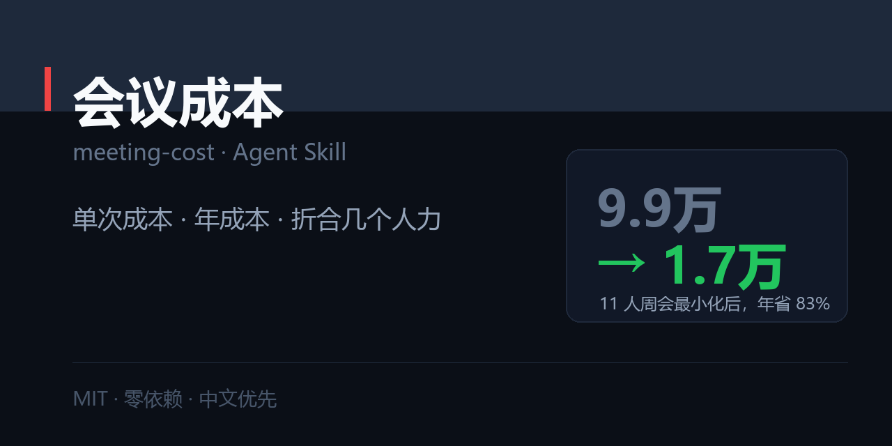

# 会议成本 · meeting-cost

> 把「开个会」变成「烧掉多少钱」：单次成本、年成本、折合几个工作日，以及砍掉它省多少。



[](./SKILL.md)
[](./LICENSE)
[](#)

---

## 一句话

```
$ python scripts/meeting_cost.py --people 11 --minutes 60 --repeat weekly --salary 22000

这个会的价格：1,970 元（单次）｜9.9 万（每年）
  参会 11 人 × 占用 85.0 分钟（会 60 分 + 准备 15 + 恢复 10）× 时薪 ¥126.4
  频率：每周，每年 50 次

换算成你能感知的东西：
  每年消耗 779 人时 = 97 个工作日
  ≈ 0.32 个全职人力（按月薪 2.2 万 × 14 薪算）
  ≈ 8 台 MacBook  /  3,284 杯咖啡

如果必须开，最小化方案：
  11 人 60 分钟 每周 → 7 人 20 分钟 每两周
  年成本 9.9 万 → 1.66 万，省 8.2 万（83.2%）
```

**上面每个数字都能用 `--json` 复现。** 这不是估算，是算式。

---

## 为什么需要这个东西

「这个会有必要开吗」是个没人能回答的问题——因为它没有价格。

一旦有了价格，讨论就从「我觉得没必要」变成「这个会一年 9.9 万，我们要不要改成双周」。**后者可以被决策。**

## 安装

```bash
git clone https://github.com/zhbehx/meeting-cost.git ~/.claude/skills/meeting-cost
```

## 用法

```bash
# 最基本的三个参数
python scripts/meeting_cost.py --people 11 --minutes 60 --repeat weekly

# 加企业综合成本（社保、工位、设备的真实开销量）
python scripts/meeting_cost.py --people 8 --minutes 60 --repeat weekly --loaded 1.4

# 按岗位取默认薪资，不用查
python scripts/meeting_cost.py --people 2 --minutes 30 --repeat weekly --role senior

# 看频率折算表
python scripts/meeting_cost.py --list-freq
```

## 算法

```
时薪 = 月薪 ÷ 21.75 ÷ 8
单次成本 = 人数 × (会议时长 + 准备 15 分 + 恢复 10 分) ÷ 60 × 时薪
年成本 = 单次成本 × 每年次数（每周 ≈ 50 次）
```

**两个容易被低估的地方**：

1. **准备与恢复时间**：一个 1 小时的会实际占用 85 分钟/人。加上这一项，成本立刻涨 42%。
2. **企业综合成本**：社保公积金 + 工位 + 设备通常再高 30–50%，用 `--loaded 1.4`。

## 实算对照表

人均月薪 2.2 万、含准备与恢复：

| 会议 | 单次 | 年成本 | 折合工作日 |
| --- | --- | --- | --- |
| 一对一（2 人 30 分 每周） | ¥232 | ¥11,590 | 11.5 |
| 跨部门对齐（12 人 90 分 每月） | ¥2,908 | ¥34,897 | 34.5 |
| 纯同步周会（8 人 60 分 每周） | ¥1,433 | ¥71,648 | 70.8 |
| 例行周会（11 人 60 分 每周） | ¥1,970 | ¥98,515 | 97.4 |
| 每日站会（6 人 30 分 每日） | ¥695 | ¥173,851 | 171.9 |

**注意最后一行**：看起来最便宜的站会，因为每天都在开，反而是最贵的一个。

## 怎么判断该不该开

一句话：**会后能不能产出「决定了什么 + 谁做什么 + 何时」？**

- 能 → 该开，但按最小化方案压
- 不能 → 改成文档/看板异步读

最狠的一问：**如果这个会取消，谁会真的受影响？** 答不出来 → 取消。

## 最小化四步（按省钱排序）

1. **减人**：去掉旁听，11 人 → 7 人省 36%
2. **减时长**：会前发材料，60 → 20 分钟省 66%
3. **降频率**：每周 → 每两周省 50%
4. **缩范围**：只讨论「必须多人同时在线才能决定」的事

三个都做：**9.9 万 → 1.66 万，省 83%**。

## 仓库结构

```
meeting-cost/
├── SKILL.md                      # 三原则 + Step 0–4 + 判断表 + 反模式
├── references/
│   └── cost-model.md             # 时薪算法、默认薪资、频率折算、换算表、最小化模板
├── scripts/
│   └── meeting_cost.py           # 成本计算 + 换算 + 最小化方案
├── examples/
│   └── 01-weekly-meeting.md      # 完整报告
└── market/social-preview.png
```

## 三个诚实的局限

1. **数字是估算，不是会计。** 它给你一个量级和比较依据，不是财务口径。
2. **算不进「被打断的深度工作」。** 一个人的下午被切成两段，损失常常超过会议本身。
3. **不能替你判断会议的价值。** 有些会花 10 万也值（比如决定裁掉一条业务线）。

## 自定义

1. **改默认薪资**：`scripts/meeting_cost.py` 顶部 `ROLE_SALARY`。
2. **改准备/恢复时间**：`--prepare` / `--recover`（默认 15 / 10 分钟）。
3. **改频率**：`FREQ_TIMES`（当前每周按 50 次/年，已扣除假期）。

## FAQ

**Q：我们公司薪资保密，拿不到数据怎么办？**
A：用 `--role` 取默认值，或直接问「人均按 2 万算」。会议成本的结论对参数不敏感——人数和频率的影响远大于薪资精度。

**Q：这会不会显得我很消极？**
A：看你拿它干什么。用来抱怨「会太多」是消极的；用来提议「这个会改成双周，省 8 万，我负责把同步改成文档」是建设性的。

**Q：一对一也有成本，是不是也不该开？**
A：反过来。一对一是这张表里 ROI 最高的一类——2 人 30 分钟每周，一年 1.16 万，但它解决的问题（对齐、反馈、留人）远超这个数。

## License

[MIT](./LICENSE)
